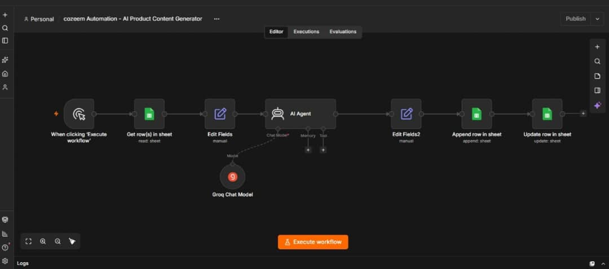

# AI Product Content Generator

An automated product content generation workflow built with n8n, Grok AI, and Google Sheets.

## Project Overview

This workflow automates the creation of e-commerce product content, reducing the need to write product descriptions and SEO content manually.

## Workflow Screenshot

## Tools Used

- n8n
- Grok AI API
- Google Sheets

## How It Works

1. Manually trigger the workflow.
2. Retrieve pending product information from Google Sheets.
3. Prepare product data for AI processing.
4. Grok AI generates product titles, descriptions, benefits, and SEO keywords.
5. Format the generated content.
6. Save the results in Google Sheets.
7. Update the original product status to Generated.

## Generated Output

- Product Title
- Product Description
- Product Benefits
- SEO Keywords

## Workflow File

The exported n8n workflow is available in this repository as a JSON file.

---

**Built by Cozeem | Cozeem Automation**
